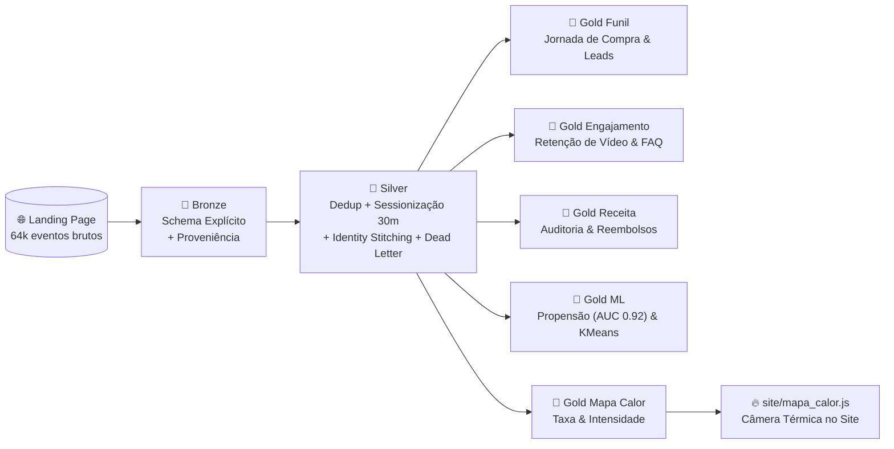
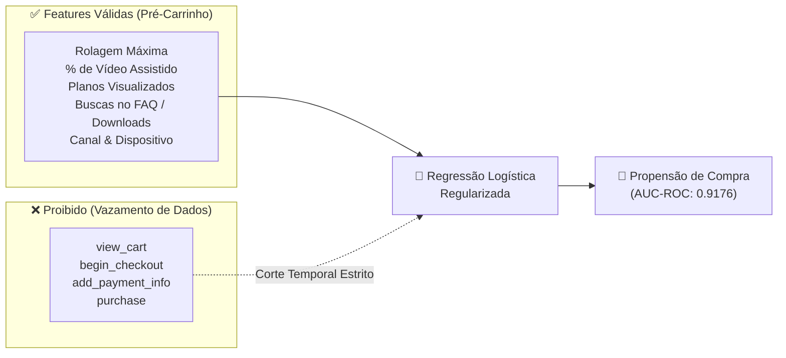
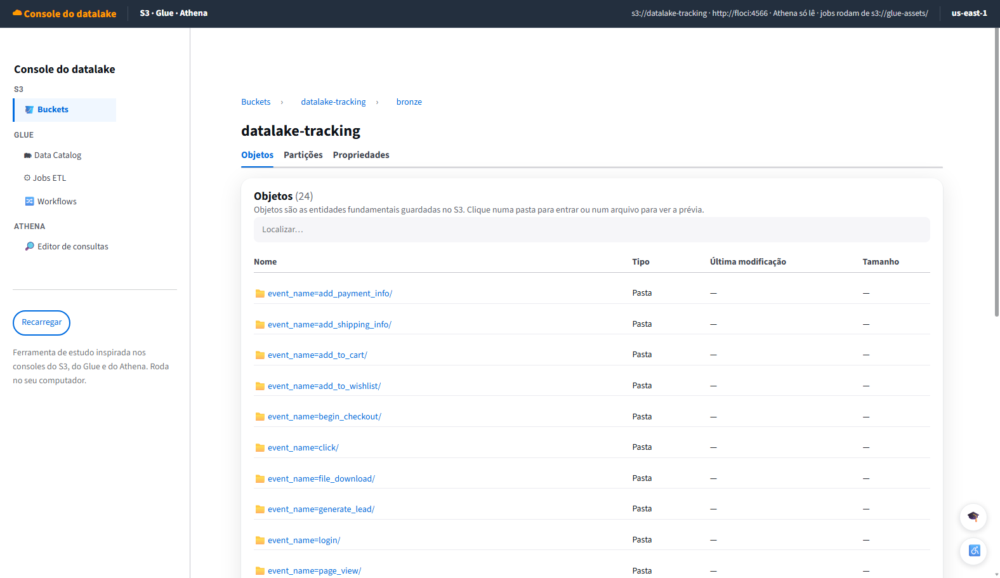
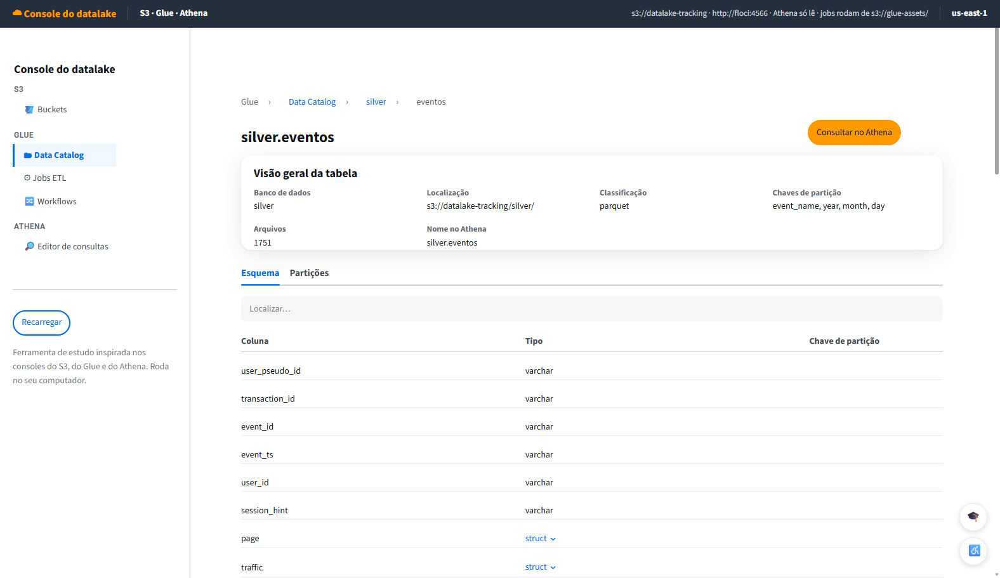
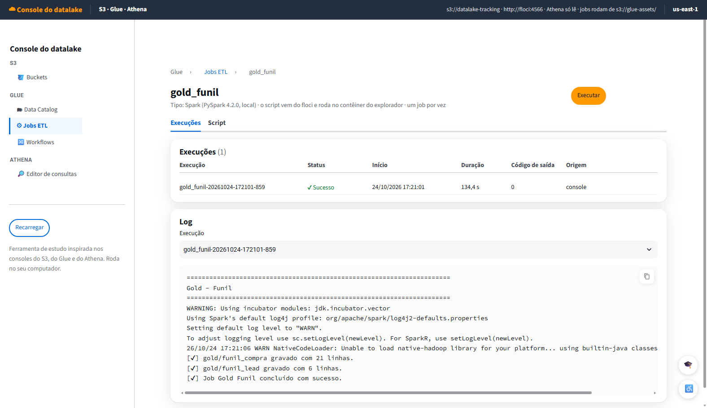
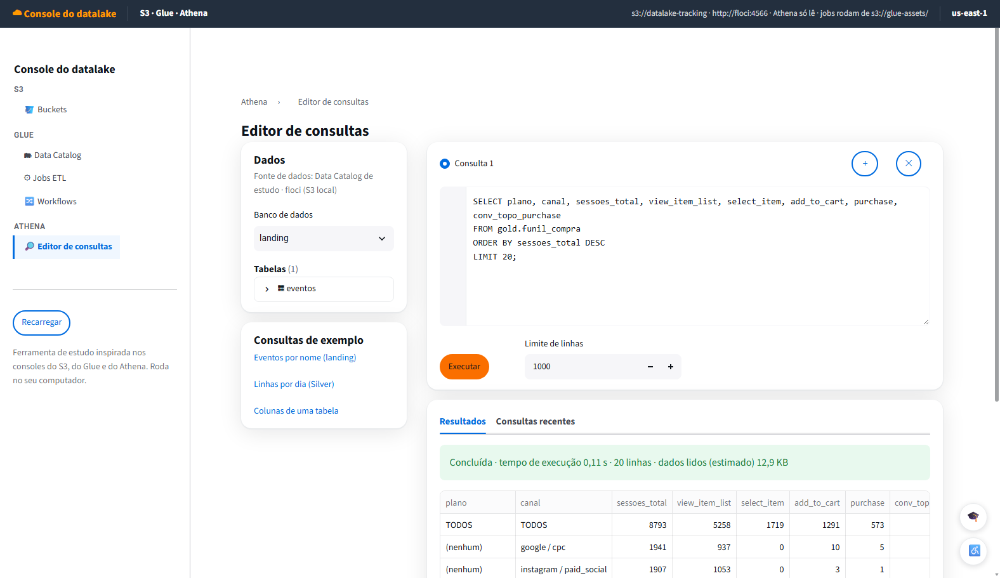

# 🚀 Data Lakehouse de Tracking de E-Commerce & Analytics com PySpark e AWS

<div align="center">


<p align="center">
  <b>Pipeline de Engenharia de Dados ponta a ponta implementando Arquitetura Medalhão (Bronze, Silver, Gold), Sessionização por Inatividade, Identity Stitching, Validação de Contrato com Dead-Letter Queue, Machine Learning sem Vazamento Temporal e Visualização Térmica Interativa.</b>
</p>

</div>

---

## 📌 Sumário Executivo

Este projeto implementa uma infraestrutura completa de **Data Lakehouse** corporativo para processamento de eventos de navegação web e transações de checkout (estilo Google Analytics 4 / Segment). 

Partindo de **64.372 eventos brutos** gerados em tempo real na Landing Page do produto **DadosPro**, o pipeline processa, higieniza, modela e entrega **15 tabelas analíticas** na camada Gold, alimentando análises de conversão, auditoria financeira, inteligência preditiva e renderização de mapa de calor no site.



---

## 🏛️ Arquitetura das Camadas (Medallion Architecture)

### 🥉 Camada Bronze (Ingestão Fidedigna & Proveniência)
* **Formato**: Parquet particionado por `event_name=<nome>/year=AAAA/month=MM/day=DD`.
* **Schema Explícito**: Definição rigorosa de tipos de dados para 20 tipos de eventos sem inferência dinâmica do Spark, garantindo previsibilidade de leitura.
* **Metadados de Auditoria**: Enriquecimento com colunas de rastreabilidade de linhagem:
  * `_arquivo_origem`: Caminho completo do arquivo JSON Lines de onde a linha nasceu (`F.input_file_name()`).
  * `_ingestao_ts`: Timestamp exato da ingestão do lote pelo Spark (`F.current_timestamp()`).
* **Append-Only**: Garantia de não-modificação de registros históricos.

---

### 🥈 Camada Silver (Higienização, Contratos & Modelagem Analítica)
* **Deduplicação (R5)**: Eliminação de 656 eventos duplicados utilizando chave única primária `event_id`.
* **Validação de Contrato de Dados & Dead-Letter Queue (R7)**:
  * Avaliação contra 6 regras de negócio estritas (timestamp na faixa válida, duração positiva de vídeo, percentual em `[0, 100]`, valores monetários estritamente positivos, rolagem em `[0, 100]` e eventos homologados).
  * **1.903 eventos inválidos** foram direcionados para `silver/eventos_rejeitados/` acompanhados da coluna diagnóstica `motivo_rejeicao`.
* **Sessionização Analítica por Inatividade (R8)**:
  * Descarte de identificadores pré-fabricados (`session_hint`).
  * Reconstrução analítica das sessões considerando janela de **30 minutos de inatividade** via funções de janela:
    $$\Delta t = \text{unix\_timestamp}(event\_ts) - \text{unix\_timestamp}(\text{lag}(event\_ts))$$
    $$\text{session\_id} = \text{concat}(user\_pseudo\_id, \text{sum}(\mathbb{I}(\Delta t > 1800)))$$
* **Identity Stitching / Resolução de Identidade (R9)**:
  * Mapeamento retroativo conectando o primeiro `user_id` autenticado (pós-lead/compra) a todos os eventos pretéritos do mesmo navegador (`user_pseudo_id`).
* **Desaninhamento de Matriz de Itens (R10)**:
  * Explosão de arrays `items[]` de compras e seleções para a tabela granular particionada `silver/itens/` (**24.427 registros**).

---

### 🥇 Camada Gold (Analytics, Machine Learning & Produto)
Composta por **15 tabelas otimizadas** consultáveis via SQL no Athena e Data Catalog:

| Domínio | Tabela | Propósito de Negócio |
| :--- | :--- | :--- |
| **Funil** | `gold.funil_compra` | Sessões em cada etapa (`view_item_list → select_item → add_to_cart → view_cart → begin_checkout → add_payment_info → purchase`), taxas de passagem e conversão sobre o topo por plano e canal. |
| | `gold.funil_lead` | Conversão de `page_view` da landing → `scroll` ≥ 50% → `generate_lead` por canal de aquisição. |
| **Engajamento** | `gold.sessoes` | Granularidade de 1 linha por sessão com duração real, total de eventos, scroll máximo, vídeo máximo, flags de lead/compra, dispositivo e canal. |
| | `gold.retencao_video` | Curva de retenção do vídeo de vendas (VSL) nos marcos de 10%, 25%, 50%, 75% e 100%. |
| | `gold.buscas_faq` | Análise de termos pesquisados e identificação de lacunas de conteúdo (`search_results = 0`). |
| | `gold.saidas_downloads` | Destinos de cliques externos e volume de downloads de e-books. |
| **Receita & LTV** | `gold.receita_diaria` | Faturamento bruto, reembolsado e líquido por data de compra, plano e canal, além de pedidos e ticket médio. |
| | `gold.taxa_reembolso` | Taxa de churn/devolução percentual por plano e canal de origem. |
| | `gold.adesao_order_bump` | Taxa de adesão à Mentoria Adicional (`BUMP-MENTORIA`) no carrinho. |
| | `gold.lead_para_compra` | Conversão de pessoas que baixaram o e-book e mediana de dias decorridos até a compra. |
| **Data Science** | `gold.propensao_sessao` | Escore de probabilidade de compra por sessão (0.0 a 1.0) para acionamento preditivo. |
| | `gold.metricas_modelo` | Registro de governança de ML (AUC, F1, Precisão, Recall e features utilizadas). |
| | `gold.segmentos_visitantes` | Clusterização KMeans dos perfis de visitantes (Compradores, Leads, Casuais). |
| **Heatmap** | `gold.mapa_calor_cliques` | Cliques, taxa de clique e intensidade normalizada por `element_id` e página. |
| | `gold.mapa_calor_rolagem` | Percentual de sessões retidas nos marcos 0%, 25%, 50%, 75% e 90% da landing page. |

---

## 🧠 Engenharia de Machine Learning: Prevenção de Data Leakage

Um dos pontos críticos e mais desafiadores na modelagem preditiva em tempo real é o **Vazamento de Informação Temporal (*Data Leakage*)**.

Se utilizarmos eventos de checkout (`view_cart`, `begin_checkout`, `add_payment_info`) como features preditoras de compra, o modelo atinge acurácia artificialmente perfeita de 99%, porém torna-se **completamente inútil na prática**, pois a empresa precisa prever a intenção do cliente **enquanto ele ainda está na Landing Page**, antes de entrar no funil de pagamento.



* **Solução Implementada**: Filtro temporal automático em cada sessão limitando as features a `event_ts < min(ts_add_to_cart)`.
* **Performance Real no Conjunto de Teste**:
  * **AUC-ROC**: `0.9176` (Altíssima capacidade discriminativa pré-checkout).
  * **F1-Score**: `0.9045`.

---

## 💼 Principais Descobertas e Insights de Negócio

Com base no relatório executivo emitido ([`RELATORIO.md`](RELATORIO.md)):

1. **O Grande Gargalo do Funil**:
   * O maior abandono de toda a jornada está entre ver a vitrine de planos (`view_item_list`) e escolher um plano (`select_item`): **queda de 67,31%**. Uma vez que o cliente seleciona o plano, a taxa de fechamento até o pagamento sobe para mais de 75%.
2. **Desempenho Financeiro e Reembolsos**:
   * **Receita Bruta Total**: R$ 338.523,10 (573 pedidos faturados com ticket médio de R$ 590,79).
   * **Reembolsos**: R$ 28.608,50 (48 estornos | taxa de 8,38%).
   * **Receita Líquida Real**: R$ 309.914,60.
   * **Order Bump**: 15,71% das compras aderiram à mentoria em grupo (`BUMP-MENTORIA`), gerando receita pura sem custo adicional de aquisição.
3. **Comportamento no Vídeo de Vendas (VSL)**:
   * 2.932 visitantes iniciaram o vídeo. 48,87% evadem antes da marca de 50%. No entanto, quem assiste além da metade tem **59,2% de chance de ver até o final**. A CTA principal deve ser adiantada para os primeiros 25% do tempo.
4. **Lacunas Críticas no FAQ**:
   * 100% das buscas por `"estagio"` (44x), `"presencial"` (33x) e `"bolsa"` (32x) retornaram vazias (`search_results = 0`), revelando dúvidas que bloqueiam vendas.
5. **Ciclo de Maturação do Lead**:
   * 522 pessoas baixaram o e-book; 40 converteram em compra posterior (7,66%). A **mediana de conversão é de 4,64 dias**, indicando o momento ideal para a automação de e-mail marketing.

---

## 📸 Galeria da Infraestrutura (Console Emulado)

<div align="center">

### 1. Bucket S3 com Particionamento Hive


### 2. Data Catalog com Schemas Tipados


### 3. Orquestração e Execução de Jobs ETL no Glue


### 4. Consultas Interativas Serverless via Athena


</div>

---

## 🛠️ Tecnologias e Boas Práticas de Engenharia

* **Conector S3A & Hadoop-AWS**: Interação transparente do PySpark com buckets S3 sem dependência de clientes locais.
* **Sobrescrita Dinâmica de Partições**: Configuração de `partitionOverwriteMode = dynamic` no Spark Writer, prevenindo que gravações na raiz apaguem diretórios vizinhos como `itens/` e `eventos_rejeitados/`.
* **Modo ANSI no PySpark 4.2**: Tratamento de timestamps ISO-8601 e uso extensivo de `F.try_divide` e `F.try_cast` para tolerância a falhas sem corrupção de pipelines.
* **Qualidade de Software**: Suíte automatizada com **280 testes unitários** cobrindo contratos de schema, lógica de lotes e cálculo de métricas.

---

## ⚙️ Como Reproduzir Localmente

Todo o ambiente é conteinerizado e roda localmente via Docker:

### 1. Clonar o repositório e subir o S3 local (floci):
```bash
git clone https://github.com/elipeBP/lakehouse-tracking-pyspark.git
cd lakehouse-tracking-pyspark
docker compose up -d floci
```

### 2. Gerar a massa de eventos sintéticos na Landing:
```bash
docker compose run --rm app python gerador/gerar_eventos.py
```

### 3. Executar o Pipeline Completo (Bronze → Silver → 5x Golds → Mapa de Calor):
```bash
docker compose run --rm app python pipeline/executar_tudo.py
```

### 4. Rodar a Bateria de Testes:
```bash
docker compose run --rm app pytest
```

### 5. Abrir o Console Web e o Site com Mapa de Calor:
* **Console do Datalake (S3 / Glue / Athena)**: Abra `http://localhost:8501`
* **Site com Câmera Térmica**: Abra `site/index.html` e clique no botão **Mapa de Calor** na barra lateral.

---

## 👨‍💻 Autor

Desenvolvido por **Felipe Padilha**  
[](https://github.com/elipeBP)
[](https://linkedin.com)
